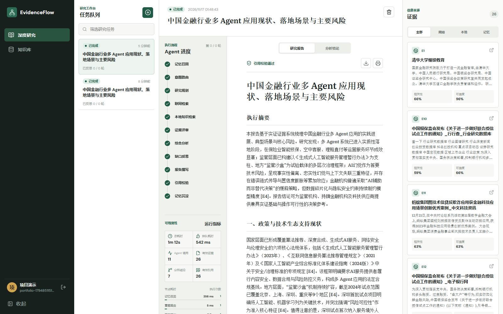
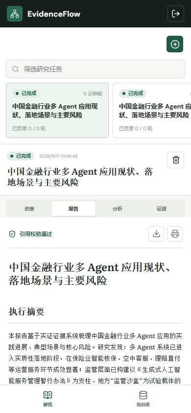

# EvidenceFlow

[](https://github.com/ZuoXing-0504/evidence-flow/actions/workflows/ci.yml)

EvidenceFlow 是一个基于 **LangGraph、Milvus、FastAPI 与 Vue 3** 构建的证据驱动多 Agent 深度研究系统。

用户输入研究主题后，系统会依次完成意图识别、任务规划、并行检索、证据评审、分析反思和报告写作，最终生成带来源编号、可校验、可追溯的 Markdown 研究报告。

## 界面预览



<p align="center">
  
</p>

## 核心能力

- 使用 LangGraph 编排 Memory Recall、Intent Router、Planner、Web Scout、Local Scout、Evidence Judge、Analyst、Reflect、Writer、Citation Validator 等研究节点；
- 通过 Bocha Web Search 与 Milvus RAG 并行召回外部资料和用户私有知识；
- 对候选证据执行中英文相关性评分、域名信誉分层、低质来源过滤、跨查询去重、来源多样性约束与质量排序；
- 在证据不足时自动生成补充查询，执行有次数上限的反思补搜；
- 对报告引用进行约束和校验，阻止不存在的证据编号进入可信报告；
- 展示 Analyst 结构化结论、置信度以及支持/反对证据映射，保留从结论到来源的推理链；
- 基于节点事件计算总耗时、Agent 调用次数和各节点耗时，提供任务级运行指标；
- 支持短期任务状态、用户级长期偏好和 Milvus 向量语义记忆；
- 使用 PostgreSQL 持久化任务、证据、分析结论、报告与可回放事件；
- 使用 Redis + ARQ 异步执行研究任务，并支持节点边界取消；
- 使用 JWT 与 Argon2id 完成身份认证，所有任务、报告、证据和知识文档均按用户隔离；
- 通过 FastAPI SSE 实时输出节点进度，断线后可依据事件编号继续回放；
- 提供中文 Vue 3 研究工作台，支持响应式桌面端与移动端；
- 知识库支持上传 TXT、Markdown 与 PDF，并自动提取文本、分块和建立向量索引；
- 支持 Markdown 下载、打印/另存为 PDF、引用校验结果展示和历史任务删除；
- Mock Provider 默认无需付费密钥，便于本地演示和自动化测试。

## 信源质量策略

Evidence Judge 不会把搜索结果直接交给模型。候选资料先经过以下处理，再按综合质量排序并生成引用编号：

| 规则 | 处理方式 |
| --- | --- |
| 主题相关性 | 英文词项与中文二元词组覆盖度评分，并融合向量检索已有分数 |
| 来源可信度 | 政府/教育/国际机构、研究机构、可信媒体、普通站点分层评分 |
| 低质来源 | 文库聚合站与用户生成内容子域降权，低于阈值时拒绝 |
| 去重 | 归一化 URL、标题与内容哈希三路去重，忽略追踪参数和页面锚点 |
| 来源多样性 | 每个注册域最多保留 3 条网页证据，降低单一信源支配报告的风险 |
| 引用排序 | 相关性与可信度加权排序，高质量证据优先获得引用编号 |

一次真实服务验收中，系统召回 34 条网页候选和 3 条历史记忆候选，最终保留 25 条网页证据与 1 条记忆证据，且单一域名不超过 3 条；报告生成 7 条结构化结论、26 个有效引用，引用校验无错误。验收后又根据实际域名分布将文档转载站与 UGC 子域补入低质来源层。该结果用于链路验收，不作为固定性能基准。

## 研究流程

```text
Memory Recall -> Intent Router -> Planner
  -> Web Scout + Local Scout
  -> Evidence Judge -> Analyst -> Reflect
  -> Writer -> Citation Validator -> Memory Commit
```

当 Reflect 判断证据不足且尚未达到迭代上限时，流程会生成补搜查询并重新进入双路检索，形成“检索 - 分析 - 补搜”的闭环。

## 技术栈

| 层级 | 技术 |
| --- | --- |
| Agent 编排 | LangGraph、Pydantic |
| API 与异步任务 | FastAPI、SSE、ARQ、Redis |
| 数据与检索 | PostgreSQL、SQLAlchemy、Alembic、Milvus、MinIO、etcd |
| 模型与搜索 | DashScope / Qwen、Bocha Web Search、内置 Mock Provider |
| 前端 | Vue 3、TypeScript、Vite、Pinia、Vue Router |
| 工程质量 | Pytest、Vitest、Ruff、MyPy、Docker Compose、GitHub Actions |

## 快速开始

### 1. 准备配置

需要 Python 3.12、[uv](https://docs.astral.sh/uv/)、Node.js 22 和 Docker。

```bash
cp .env.example .env
```

默认配置使用 Mock Provider，不需要任何付费 API Key。请勿把真实密钥提交到仓库。

### 2. 启动基础设施

```bash
docker compose up -d postgres redis etcd minio milvus
```

### 3. 启动后端与 Worker

```bash
uv sync --project backend
uv run --project backend alembic upgrade head
uv run --project backend uvicorn app.main:app --reload --app-dir backend
uv run --project backend arq app.jobs.WorkerSettings
```

API 默认地址为 `http://localhost:8000`，接口文档位于 `http://localhost:8000/docs`。

### 4. 启动前端

```bash
cd frontend
npm ci
npm run dev
```

研究工作台默认位于 `http://localhost:5173`。

也可以使用 Docker 一次启动完整应用：

```bash
docker compose --profile app up --build
```

Docker 完整栈默认将 API 映射到 `http://localhost:8010`，Redis 映射到宿主机 `6380`，避免与常见的本地开发服务冲突；容器之间仍使用标准端口通信。

博查多查询检索默认按 1 秒间隔顺序发送，并对 `HTTP 429` 遵循 `Retry-After` 或执行指数退避，避免研究规划生成多个查询时触发突发限流。

## 接入真实服务

在本地 `.env` 中设置：

```dotenv
LLM_PROVIDER=dashscope
WEB_SEARCH_PROVIDER=bocha
EMBEDDING_PROVIDER=dashscope
DASHSCOPE_API_KEY=your-key
BOCHA_API_KEY=your-key
```

Provider 调用具备超时、有限重试、结构化输出校验与严格证据 ID 映射。默认单次请求超时为 90 秒，以容纳包含多条证据的长报告生成；即使不配置真实服务，系统仍可通过确定性的 Mock 数据完整演示研究链路。

## 知识库

`POST /api/documents` 接收标题、正文和可选来源链接；`POST /api/documents/upload` 接收最大 10 MB 的 TXT、Markdown 或 PDF 文件。系统会提取文本、分块、生成向量并写入当前用户的 Milvus 分区，研究任务中的 Local Scout 只会召回该用户自己的内容。

Docker 环境使用 Milvus 作为共享向量存储；测试和单进程开发也可使用内存向量存储。默认确定性 Embedding 不依赖外部接口，配置 `EMBEDDING_PROVIDER=dashscope` 后会改用 `text-embedding-v3`。

## 测试与质量检查

```bash
uv run --project backend pytest backend/tests
uv run --project backend ruff check backend
uv run --project backend ruff format --check backend
uv run --project backend mypy backend/app

cd frontend
npm test
npm run build
```

GitHub Actions 会分别验证后端、前端和 Docker Compose 配置。

## 项目结构

```text
backend/                 FastAPI 服务、领域模型、Agent 图、检索适配器与测试
frontend/                Vue 3 中文研究工作台与 Nginx 运行配置
docs/                    桌面端与移动端演示截图
.github/workflows/       持续集成配置
docker-compose.yml       PostgreSQL、Redis、Milvus 与应用编排
```

## License

MIT
